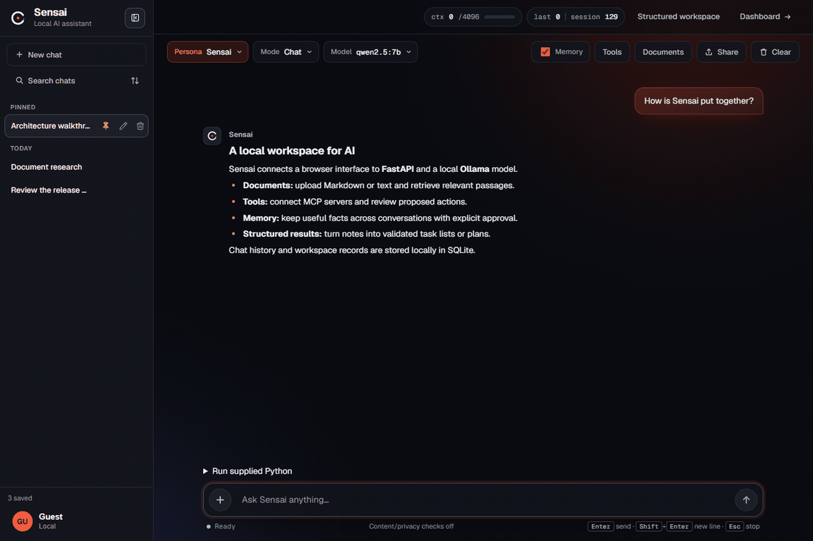
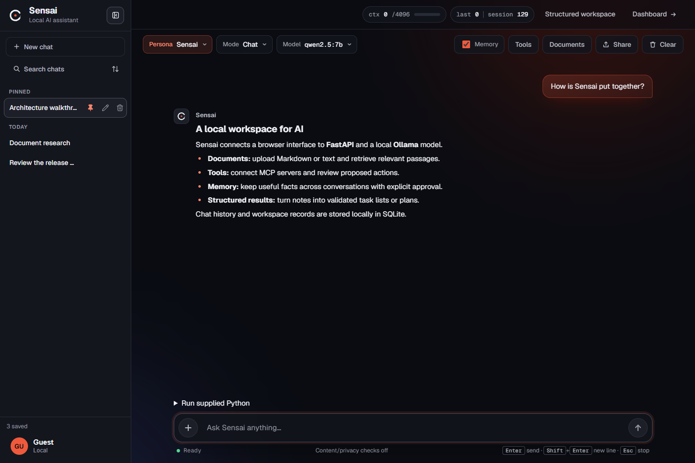
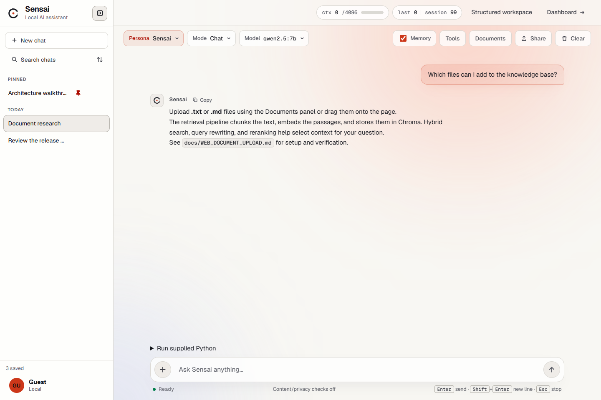
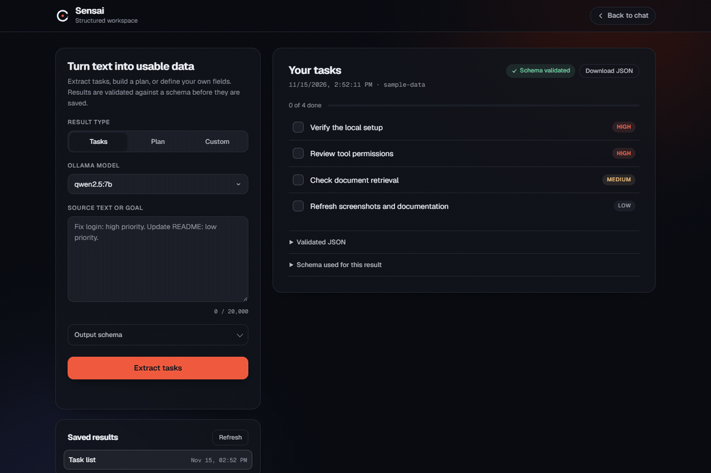
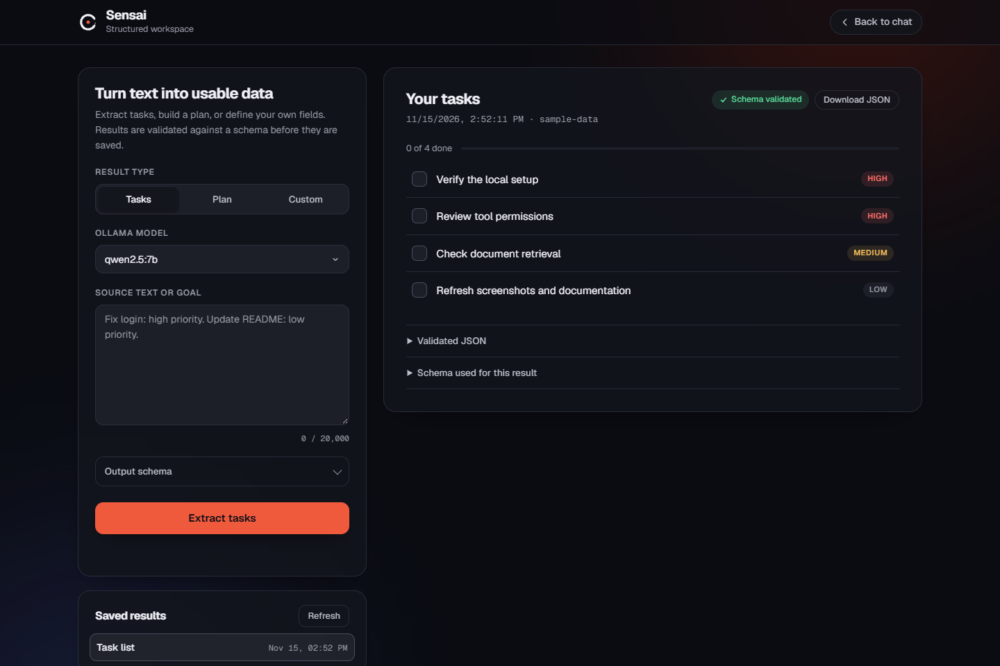

<div align="center">

<h1>Sensai</h1>

**A local AI workspace for chat, documents, and tools.**

Research software projects, work with your files, and turn notes into structured results with Ollama.

[Features](#features) · [App preview](#app-preview) · [Run the web app](#run-the-web-app) · [Documentation](docs/README.md)


</div>

## App preview



<table>
  <tr>
    <td width="50%"></td>
    <td width="50%"></td>
  </tr>
  <tr>
    <td align="center">Saved conversations &amp; model controls</td>
    <td align="center">Light and dark appearance</td>
  </tr>
</table>



<details>
<summary>Structured workspace screenshot</summary>



</details>

Captured from the running web app with isolated sample conversations and a seeded task list.
The GIFs show real navigation, appearance changes, and persisted checklist updates;
the sample text is illustrative and does not demonstrate live model inference or extraction.

## Features

| Area | What you can do |
| --- | --- |
| **Chat workspace** | Stream replies, switch personas and local models, pin and search saved chats, or start a temporary conversation. |
| **Document retrieval** | Upload Markdown or text; use Chroma-backed retrieval with hybrid search, query rewriting, and reranking. |
| **Tools & permissions** | Connect MCP servers, manage tool access, review proposed actions, and inspect execution feedback. |
| **Web research** | Search through a local SearXNG provider and inspect the sources returned to the assistant. |
| **Python sandbox** | Review and run supplied or proposed Python in Linux isolation with Bubblewrap and seccomp. |
| **Memory** | Keep scoped facts across conversations with explicit approval for changes. |
| **Structured results** | Produce schema-validated tasks, plans, or custom records; track checklist progress and export JSON. |
| **Artifacts & observability** | Edit versioned documents, export snapshots, and inspect run events in the dashboard. |

This repository is a personal public copy of a collaborative Epitech project.
The original development history and contributor attribution are preserved.
The web app is designed for local use; see the setup below and the [verification guide](docs/VERIFY.md) for prerequisites and coverage limits.

## Run the web app

Use **Ubuntu 24.04** directly or inside **WSL 2**. Run the commands below in an
Ubuntu terminal from the repository root. For Ollama installation and basic
environment troubleshooting, see [START.md](START.md).

### First run

Install the project and sandbox dependencies, then download Qwen 2.5 7B:

```bash
sudo apt update
sudo apt install -y git python3 python3-venv bubblewrap libseccomp2
python3 -m venv .venv
source .venv/bin/activate
python -m pip install -r requirements-mcp.txt
ollama pull qwen2.5:7b
```

If Ollama is not running, start `ollama serve` in a separate Ubuntu terminal
before pulling the model. Check the connection with
`curl http://127.0.0.1:11434/api/tags`.

Start Sensai and install its local SearXNG provider:

```bash
python deploy/start_b.py --port 8020 --model qwen2.5:7b --install-search
```

The first launch needs internet access to install the search provider. The
launcher starts SearXNG on port `8088` or reuses a healthy provider already
running there. It then starts the web app with the integrated MCP tools and demo
guardrails.

### Subsequent runs

```bash
source .venv/bin/activate
python deploy/start_b.py --port 8020 --model qwen2.5:7b
```

Open [Sensai](http://127.0.0.1:8020), start a new chat, select **Chat**, and confirm
that the model is **qwen2.5:7b**. Keep **Allow tools** enabled for MCP, web search,
and Python. A reopened chat can restore its previous model, so check the model
picker when reusing a session.

Try asking “Find the official Python sqlite3 documentation online and give me
the source link.” Approve the proposed search, then open **Web sources** to
inspect the results. To try Python, ask “Use Python to calculate the sum of the
integers from 1 to 10,” approve the proposed code, and inspect the tool output.

Press **Ctrl+C** in the launcher terminal to stop the services it started. If
port `8020` is busy, pass a different `--port`; port `8088` is reserved for
search. Keep the web app bound to localhost because its UI and API are
unauthenticated.

## Other entry points

| Workflow | Where to start |
| --- | --- |
| Basic terminal chat | `python chatbot.py --model qwen2.5:7b` with the virtual environment active |
| Manage MCP connections and per-tool permissions | **Tools** in the web app and the [MCP guide](docs/MCP_CONNECTIONS.md) |
| Run or repair Python in isolation | [Sandbox guide](docs/SANDBOX.md) |
| Read, create, or update permitted files | [File permissions](docs/FILE_PERMISSIONS.md) |
| Save facts or recall a previous conversation | **Memory** in chat and the [memory guide](docs/MEMORY.md) |
| Extract tasks and plans, track progress, and export JSON | [Structured workspace](http://127.0.0.1:8020/structured) and the [structured output guide](docs/STRUCTURED_WORKSPACE.md) |
| Upload and query project documents | [Document retrieval](docs/WEB_DOCUMENT_UPLOAD.md) |
| Inspect run events | [Dashboard](http://127.0.0.1:8020/dashboard) and the [quality guide](docs/QUALITY.md) |

## Architecture and verification

FastAPI serves the web app and API. Python services handle tool calls, permissions,
and structured output. Model requests go directly to Ollama over HTTP. The MCP
SDK manages tool connections, and Bubblewrap and seccomp isolate Python execution.
SQLite stores sessions, structured results, memory, and run events.

```bash
python -m pip install pytest
python -m pytest tests -q
```

See [verification](docs/VERIFY.md) for test prerequisites and recorded results,
the [demo runbook](docs/DEMO.md) for walkthroughs, and the [documentation
index](docs/README.md) for architecture, configuration, and the feature register.
